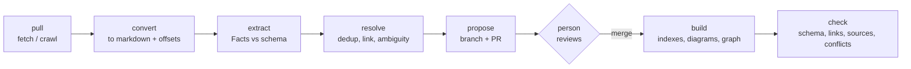

# domainlore: plan

> Status: v0.1.0 released, 2026-10-30; v0.2a next. Where this plan and [ADR 0002](docs/adr/0002-okf-with-domainlore-extension.md) differ, the ADR wins.
> Produced from a design interview; every decision below was accepted by the owner. Vocabulary is defined in [GLOSSARY.md](GLOSSARY.md). Architecture decisions live in [docs/adr/](docs/adr/).

## 1. Purpose

AI coding agents write specs, test cases and code with almost no knowledge of the business domain. That knowledge is scattered across Jira, Confluence, Word and PDF documents, the running app and the code, and it often contradicts itself.

**domainlore** collects sourced Facts about a product's domain from those places, organises them in a light ontology, and serves them to **any** AI coding agent as layered markdown that the agent reads only when it needs to.

The primary goal: when an agent prepares a test case, a specification or code, it can find the right domain Facts quickly, see where each Fact came from and how far it is trusted, and see where the sources disagree.

## 2. Goals and non-goals

**Goals**

- Sourced Facts only. Every Fact cites at least one Source, down to the page, section or line.
- A light ontology: seven Node Types, a fixed relation set, extensible by configuration. Not OWL, not RDF.
- Progressive disclosure: root index → Area index → Node page → Source.
- Intended (what should happen) vs Actual (what happens) on every Fact. Contradictions surface as **Gaps** and **Spec Conflicts** and are never silently resolved.
- People stay in control: extraction produces Proposals; a person merges them through a normal pull request.
- Agent-agnostic: works with any agent that can read files and run a shell command.
- Free and open source end to end; no hosted service, no database server, no API key of its own.
- Deterministic work in scripts; the LLM only extracts, names and judges.

**Non-goals (v1)**

- A full ontology language, reasoning or inference engine.
- A graph database as the source of truth (see [ADR 0001](docs/adr/0001-markdown-is-the-source-of-truth.md)).
- A hosted or multi-tenant service.
- Figma as a source (deferred: designs show UI, not entities and relations).
- Knowledge federated across several repos.

## 3. Decision log

| # | Decision |
|---|---|
| Q1 | New standalone repo, Apache-2.0. Not tied to any other project. |
| Q2 | Markdown with typed YAML frontmatter is the source of truth; the graph and indexes are derived ([ADR 0001](docs/adr/0001-markdown-is-the-source-of-truth.md)). |
| Q3 | Seven Node Types: Entity, Rule, Actor, Journey, Screen, Term, Source. Fixed relation set, extensible by configuration. |
| Q4 | Every Fact cites a Source and carries a trust level. Contradictions are recorded as Conflicts. |
| Q5 | Extraction writes Proposals; a person approves them by merging a pull request. |
| Q6 | Three Layers: L0 root index, L1 Area index, L2 Node page; plus a `query` CLI. |
| Q7 | Python with `uv`; scripts for deterministic work. |
| Q8 | Source content stays in the product's own repo; redaction before writing; no API key of its own. |
| Q9 | One Knowledge Base per repo in v1; Areas as folders. |
| Q10 | Every Fact has a basis: Intended or Actual. Intended vs Actual Conflict = Gap; Intended vs Intended = Spec Conflict. |
| Q11 | "Area" is the user-facing word for a bounded context. |
| Q12 | ADR 0001 recorded. |
| Q14 | On-disk format is Google's Open Knowledge Format (OKF) v0.2, extended. |
| Q15 | Trust levels use OKF words: unverified, machine-confirmed, human-reviewed. |
| Q16 | Own Python project; borrow ideas from LangChain OpenWiki rather than build on it. |
| Q17 | The calling agent extracts by default; Google LangExtract is an optional scripted extractor. |
| Q18 | Schema defined once in LinkML; frontmatter validator and Pydantic models generated from it. SKOS field names for Terms. |
| Q19 | Source order: documents → Confluence + Jira → code → live app. Figma deferred. |
| Q20 | Own read-only REST client for Jira and Confluence batch pulls; `mcp-atlassian` recommended for interactive use, not bundled. |
| Q22 | Own Playwright breadth-first crawler in Python; network JSON kept as evidence. |
| Q23′ | Agent-agnostic core (CLI + `knowledge/` + AGENTS.md pointer); SKILL.md skills; thin per-agent adapters; MCP after v1. |
| Q24 | `knowledge/GLOSSARY.md` generated from Term pages in the Matt Pocock glossary format. |
| Q25 | Mermaid diagrams are generated from frontmatter, never hand-edited. |
| Q26 | Diagram set per page kind (section 8). Max ~25 nodes per diagram. |
| Q27 | Entity Lifecycle is a `states`/`transitions` field on the Entity, not a new Node Type. |
| Q28 | Diagrams show basis and trust visually, with a legend. |
| Q29 | Name: `domainlore`; CLI: `lore`. |
| Q30–Q37 | Release cut in section 13; demo product as test bed; GitHub quark-sri, install from git, no PyPI or tags without the owner; Word (MarkItDown) and PDF (Docling) as optional inputs; exact-location citations; originals stay in place; documents default to Intended with date and version recorded. |
| Q38 | Ambiguity is resolved from other Sources first, then from the production code when available, then by asking a person (section 7). |
| ADR 0002 | Follow OKF where it already decides: path = concept ID, trust derived from `verified` events, sources inline with footnote citations (no Source pages), Area diagrams in a generated `map.md`, Conflicts as `Gap` / `Spec Conflict` concepts. |

## 4. Domain model

Full definitions: [GLOSSARY.md](GLOSSARY.md).

### 4.1 Node Types

| Type | Meaning | Example |
|---|---|---|
| Entity | A thing in the business domain | Order, Customer, Invoice |
| Rule | A business rule or constraint | "An Order over €10k needs approval" |
| Actor | A role a person or system plays | Approver, Guest |
| Journey | A goal-driven sequence of steps | Checkout, Refund request |
| Screen | A UI page or state | Order Details |
| Term | A word, synonym or abbreviation | "PO" → Purchase Order |
| Source | The origin of a Fact, stored as an OKF `sources` entry on the page that uses it (no own page) | JIRA-123, a Confluence page, `spec.pdf` p.12, a crawl run, `src/orders/service.py:40` |

### 4.2 Relations

| Relation | From → To |
|---|---|
| `has` / `belongs_to` | Entity → Entity |
| `governs` | Rule → Entity (also via a Transition's `governed_by`) |
| `performs` | Actor → Journey |
| `navigates_to` | Screen → Screen |
| `shows` | Screen → Entity |
| `step_of` | Screen → Journey |
| `aka` | Term → any Node |

Citation is not a relation: a page lists its `sources`, and facts point to them by footnote `[^id]` or `cites: [id]`.

Teams may add relation types in `lore.toml`; the extractor may *propose* new types or relations, which go to review and are never added silently.

### 4.3 Every Fact carries

- **cites**: one or more Sources, with an exact location.
- **basis**: `intended` (tickets, docs) or `actual` (running app, code).
- **verified** (OKF): a list of `{by, at}` events; the tier is derived: none → `unverified`, only non-human actors → `machine-confirmed`, a `human:<id>` actor → `human-reviewed`.
- **status / stale_after** (OKF): so old Facts can expire.

### 4.4 Conflicts

| Kind | Between | Meaning | Who acts |
|---|---|---|---|
| **Gap** | Intended vs Actual | Likely defect or missing feature | Tester / developer |
| **Spec Conflict** | Intended vs Intended | Sources disagree on what should happen | Product owner |

Conflicts show both Sources with their dates and versions. The tool never picks a winner.

### 4.5 Entity Lifecycle

An Entity may declare `states` and `transitions`. Each Transition names its trigger Actor, its guarding Rule(s) and its Sources. This is where most business bugs hide, so the Entity page always renders it as a state diagram.

## 5. On-disk layout

### 5.1 In the product repo (output)

```text
lore.toml                      # sources, Areas, extra relation types, redaction rules
knowledge/
  index.md                     # L0: Areas + top Nodes, one line each (≤ ~150 lines)
  map.md                       # generated context map of the Areas
  GLOSSARY.md                  # generated from Entity, Actor and Term pages (never hand-edited)
  log.md                       # append-only change log (OKF)
  questions.md                 # Open Questions waiting for a person
  conflicts/                   # one page per Gap / Spec Conflict
  billing/                     # an Area
    index.md                   # L1: Nodes in the Area, grouped by type
    map.md                     # generated ER and navigation diagrams
    entities/invoice.md        # L2
    rules/late-fee.md
    journeys/pay-invoice.md
    screens/invoice-list.md
    actors/accountant.md
    terms/dunning.md
.lore/                         # git-ignored
  cache/                       # converted documents, raw API JSON, crawl artefacts
  graph.json                   # derived graph for `lore query`
```

`lore init` adds a short pointer block to `AGENTS.md` (and to `CLAUDE.md` when present), such as:

```markdown
## Domain knowledge
Business domain facts live in `knowledge/`. Start at `knowledge/index.md`, open only the Area and pages you need.
Prefer `human-reviewed` facts; treat `unverified` ones as hints. Check `knowledge/conflicts/` before writing tests.
For cross-cutting questions run `lore query "<question>"`.
```

### 5.2 Example L2 page

````markdown
---
type: Entity                 # OKF required field; the concept ID is the path
title: Invoice
description: A request for payment sent to a Customer after delivery.
aliases: [Bill]
relations:
  belongs_to: [billing/entities/customer]
  has: [billing/entities/invoice-line]
states: [draft, issued, paid, overdue, cancelled]
transitions:
  - {from: issued, to: overdue, trigger: system, governed_by: [billing/rules/late-fee],
     basis: intended, cites: [bil-212]}
  - {from: issued, to: paid, trigger: billing/actors/customer, basis: actual, cites: [code]}
basis: intended
verified: { by: human:ann, at: 2026-10-01T09:00:00Z }
sources:
  - { id: bil-212, resource: https://jira.example.com/browse/BIL-212 }
  - { id: model, resource: https://wiki.example.com/display/BIL/Invoice+model, version: "7" }
  - { id: brd, resource: ../specs/Billing-BRD.pdf#page=12 }
  - { id: code, resource: ../src/billing/invoice.py#L88-L120, basis: actual }
---

# Invoice

A request for payment sent to a Customer after delivery. …

## Lifecycle
<!-- generated:start -->

<!-- generated:end -->

## Sources
- …
````

Field names follow OKF v0.2; our additions are listed in [ADR 0002](docs/adr/0002-okf-with-domainlore-extension.md) and the field reference is [skills/lore-use/page-format.md](skills/lore-use/page-format.md).

## 6. Pipeline



| Stage | Done by | Notes |
|---|---|---|
| pull | script | Incremental: Jira `updated` JQL + changelog, Confluence page versions, file hashes, git diff, re-crawl of changed routes. |
| convert | script | MarkItDown (docx), Docling (pdf), confluence-markdown-exporter; keep character offsets for citation. |
| extract | agent (default) or LangExtract (optional) | Schema-guided against the LinkML schema; each Fact keeps its source span. |
| resolve | script + agent | Dedup by external ID (issue key, page ID, route, code symbol) + aliases; agent judges only ambiguous merges. Detect Conflicts. Run ambiguity resolution (section 7). |
| propose | script | Writes changes on a branch and opens a PR; only files whose evidence changed are touched (OpenWiki's evidence-drift idea). |
| review | person | Merge = `human-reviewed` for the Facts in the PR. |
| build | script | Regenerates indexes, GLOSSARY.md, Mermaid blocks, `graph.json`. |
| check | script, CI | Fails on schema errors, broken links, Facts without Sources, hand-edited generated blocks, stale Facts. |

## 7. Ambiguity resolution

When extraction meets an ambiguity — a vague term ("large orders"), a missing value ("limit to be confirmed"), or a rule that two readings fit — resolve in this order:

1. **Other Sources already pulled.** Another ticket, page or document may settle it.
2. **Production code, when available.** The agent explores the code read-only (optionally with a code-graph tool such as graphify for large codebases) and records what it finds as an **Actual** Fact citing file and lines, at `machine-confirmed`.
   - If the code *clarifies* the Intended Fact (the "large order" threshold is 10 000 in both), the Intended Fact is linked to the code evidence and raised to `machine-confirmed`.
   - If the code *contradicts* the Intended Fact, that is a **Gap**, not a resolution. Code shows what the product does, not what it should do.
3. **Ask a person.** Interactive runs ask the user in the session; batch and CI runs append an **Open Question** to `knowledge/questions.md` and keep the Fact `unverified`.

The order is configurable in `lore.toml` (`ambiguity.order = ["sources", "code", "ask"]`); a team that wants a person to decide first sets `["sources", "ask", "code"]`.

## 8. Diagrams (Mermaid)

| Page | Diagram | Shows |
|---|---|---|
| Root `map.md` | `flowchart` | Areas and their dependencies (context map) |
| Area `map.md` | `erDiagram` | Entities and relations in the Area |
| Area `map.md` | `flowchart` | Screen-to-Screen navigation |
| L2 Journey | `flowchart` or `sequenceDiagram` | Steps, decisions, Screens; sequence when several Actors or systems take part |
| L2 Entity | `stateDiagram-v2` | Lifecycle, if declared |

Visual encoding, with a one-line legend under each diagram:

| Element | Style |
|---|---|
| Intended only | dashed |
| Actual only | orange |
| Part of a Gap | red, ⚠ label linking to the Gap page |
| Unverified | grey label |

Limits: ~25 nodes per diagram; larger diagrams are split and linked. Generated blocks sit between `<!-- generated:start -->` / `<!-- generated:end -->`; `lore check` fails if they were edited by hand.

## 9. Sources

| Source | Basis | Batch (built into domainlore) | Interactive (recommended, not bundled) | Version |
|---|---|---|---|---|
| Markdown, Word, PDF | Intended (configurable per folder) | MarkItDown (docx), Docling (pdf, OCR off by default) | — | v0.2a |
| Confluence | Intended | Own REST client or `confluence-markdown-exporter` | `sooperset/mcp-atlassian` (read-only mode) | v0.2b |
| Jira | Intended | Own REST client: JQL + changelog; API token (Cloud) / PAT (Data Center) | `sooperset/mcp-atlassian` | v0.2b |
| Production code (ambiguity) | Actual | Agent-driven read-only exploration | any code graph tool | v0.2a |
| OpenAPI | Actual | Own walker: bundle spec, `components.schemas` → Entities, `$ref` → relations, `paths` → operations | — | v0.3 |
| Database schema | Actual | `tbls` (MIT) JSON/markdown → Entities and relations | — | v0.3 |
| Live app | Actual | Own Playwright BFS crawler (section 9.1) | Playwright MCP / playwright-cli | v0.4 |
| Figma | Intended | — | — | deferred |

Document Sources record path, `sha256`, document date and version, and page (PDF) or section (Word) plus character span. Originals are never copied into the repo; converted text lives in `.lore/cache/`.

### 9.1 Crawler design

- State identity: normalised route (`/orders/:id`) + hash of the accessibility tree (roles + names, no values).
- Edges: (state, action on element role + name) → new state; record URL change, dialog or in-page change.
- Forms: fields, required flags and options from the accessibility tree; the resulting request body.
- Entities: from network JSON responses, table headers and detail labels; matched to OpenAPI schemas when present.
- Auth: log in once, reuse Playwright `storageState`; never store credentials in the Knowledge Base.
- Safety: test environment only; deny list for destructive actions (delete, pay, logout, submit-final).
- LLM pass only on new states, to name Screens and Entities.

## 10. Agent integration

| Piece | What it is | Who it serves |
|---|---|---|
| CLI `lore` | `init`, `pull`, `extract`, `build`, `check`, `query`, `path`, `explain` | Every agent and CI |
| `knowledge/` + AGENTS.md block | The Knowledge Base and how to find it | Every agent |
| Skills (SKILL.md, open Agent Skills format) | `lore-use` (answer domain questions, cite Facts), `lore-extract` (Facts from a Source), `lore-resolve` (ambiguity order, section 7), `lore-review` (review a Proposal) | Agents that load SKILL.md: Claude Code, Codex, Cursor, Copilot, Gemini CLI and others |
| Adapters | Claude Code plugin manifest + `marketplace.json`; Cursor rule; others as needed. Packaging only, no logic. | Per ecosystem |
| MCP server | Thin `search` / `read` / `query` tools | After v1, for agents without a shell |

The `query` / `path` / `explain` commands mirror graphify's interface because agents already know that shape.

## 11. Security and privacy

- The open-source project ships tooling only. Each team's Knowledge Base lives in its own repo.
- Read-only access to every source. Tokens come from environment variables; never written to disk by domainlore.
- Redaction pass before anything is written: secrets, emails, personal data, configurable patterns.
- Source pages hold location and metadata, not copies of confidential documents.
- LLM calls go through the agent the team already uses; LangExtract with a local model (e.g. Ollama) for fully offline runs.
- Licence hygiene: no AGPL or GPL dependencies (excludes Basic Memory, Skyvern, Firecrawl, pymupdf4llm and others).

## 12. Testing domainlore itself

- **Demo product** `examples/order-approval/`: a small fictional app with fixture Jira JSON, Confluence pages, a Word BRD, a PDF policy, an OpenAPI spec, a SQL schema and a tiny web app for the crawler. It doubles as the README walkthrough.
- **Planted contradictions** in the demo: each must surface as the expected Gap or Spec Conflict.
- **Golden-file tests**: generated pages, indexes, GLOSSARY.md and Mermaid blocks compared with approved copies.
- **Unit tests** for schema validation, ID normalisation, dedup, redaction, diagram splitting.
- **Agent eval**: ~30 domain questions about the demo product; an agent must answer them correctly and cite the right Fact using only `knowledge/`. Track accuracy and tokens read per answer, to prove progressive disclosure pays off.

## 13. Releases

| Version | Scope | Done when |
|---|---|---|
| **v0.1** | LinkML schema + OKF mapping; `init`, `build`, `check`, `query`; Mermaid generation; AGENTS.md block; `lore-use` skill; demo Knowledge Base written by hand | A team can hand-write pages and get validation, indexes, diagrams and agent discovery |
| **v0.2a** | Local documents (md, docx, pdf); extraction; resolve incl. ambiguity order; Proposals as PRs; `lore-extract`, `lore-resolve`, `lore-review` skills | Demo documents produce a correct Proposal with exact citations and the planted Spec Conflicts |
| **v0.2b** | Confluence + Jira batch pull on the same pipeline; incremental sync | Demo fixtures sync incrementally, no churn on a no-op run |
| **v0.3** | OpenAPI walker; database schema via tbls | First Gaps detected from the demo |
| **v0.4** | Playwright crawler | Demo app crawled into Screens, navigation and Entities; navigation Gaps found |
| **Later** | MCP server; Figma; several repos per Knowledge Base; MkDocs site for people | — |

## 14. Steps to start the repo

1. ✅ **Confirm the format.** OKF v0.2 read; mapping in ADR 0002.
2. ✅ **Create the repo** `quark-sri/domainlore` (public, Apache-2.0).
3. ✅ **Scaffold**: `uv` package, Typer CLI, pytest, ruff, GitHub Actions (tests, demo check, retrieval eval, schema drift).
4. ✅ **LinkML schema** `schema/domainlore.yaml` → JSON Schemas (`scripts/gen-schema.sh`). Pydantic models not generated yet; validation uses JSON Schema.
5. ✅ **Demo Knowledge Base** `examples/order-approval/`: 19 pages, two Areas, two Gaps, one Spec Conflict.
6. ✅ **`build` and `check`**: indexes, maps, glossary, Mermaid blocks, `.lore/graph.json`, golden test.
7. ✅ **`query` / `path` / `explain`** (keyword + type hints; retrieval eval hit@5 93%).
8. ✅ **`init`** (lore.toml, AGENTS.md / CLAUDE.md block, Cursor rule) and the `lore-use` skill + Claude Code plugin.
9. ✅ **Manual agent eval** (`evals/README.md`: 30/30 correct) and **tag v0.1.0**.
10. ⏳ Continue with v0.2a per section 13.

## 15. Prior art and how we use it

Stars, licences and last-push dates checked with the GitHub API on 2026-10-30.

| Project | Licence | Use |
|---|---|---|
| [Google Open Knowledge Format (knowledge-catalog)](https://github.com/GoogleCloudPlatform/knowledge-catalog) | Apache-2.0 | **Adopt** as the on-disk format (`okf/SPEC.md`) |
| [LangChain OpenWiki](https://github.com/langchain-ai/openwiki) | MIT | **Borrow**: evidence-linked claims, evidence-drift updates, no-churn runs, AGENTS.md block, search/read tools. Code-only sources, TypeScript. |
| [Google LangExtract](https://github.com/google/langextract) | Apache-2.0 | **Adopt (optional)**: schema-guided extraction with character offsets, local models |
| [LinkML](https://github.com/linkml/linkml) | Apache-2.0 | **Adopt**: schema → JSON Schema + Pydantic |
| [SKOS](https://www.w3.org/TR/skos-reference/) | W3C | **Borrow** field names for Terms (`prefLabel`, `altLabel`, `broader`) |
| [Graphiti](https://github.com/getzep/graphiti) | Apache-2.0 | **Borrow**: typed entity/edge models, raw-input provenance, superseded facts kept with time |
| [graphify](https://github.com/Graphify-Labs/graphify) | Apache-2.0 | **Borrow** the query/path/explain interface and EXTRACTED/INFERRED tags; optional code-graph helper for ambiguity resolution |
| [Basic Memory](https://github.com/basicmachines-co/basic-memory) | AGPL-3.0 | **Ideas only**: Observation/Relation markdown grammar |
| [Matt Pocock skills: domain-modeling](https://github.com/mattpocock/skills) | MIT | **Adopt** GLOSSARY.md and ADR formats |
| [Microsoft MarkItDown](https://github.com/microsoft/markitdown) | MIT | **Adopt** for docx |
| [Docling](https://github.com/docling-project/docling) | MIT | **Adopt** for pdf |
| [confluence-markdown-exporter](https://github.com/Spenhouet/confluence-markdown-exporter) | MIT | **Adopt or borrow** for Confluence export |
| [sooperset/mcp-atlassian](https://github.com/sooperset/mcp-atlassian) | MIT | **Recommend** for interactive Jira/Confluence |
| [tbls](https://github.com/k1LoW/tbls) | MIT | **Adopt** for database schemas |
| [Playwright](https://github.com/microsoft/playwright), [Playwright MCP](https://github.com/microsoft/playwright-mcp) | Apache-2.0 | **Adopt** Playwright for the crawler; recommend MCP / CLI for interactive use |
| [Crawljax](https://github.com/crawljax/crawljax), AutoE2E ([arXiv 2408.01894](https://arxiv.org/abs/2408.01894)), WebNavigator ([arXiv 2603.20366](https://arxiv.org/abs/2603.20366)) | — | **Design reference** for state identity and state-flow graphs |
| Karpathy "LLM wiki" pattern, [llm-wiki-agent](https://github.com/SamurAIGPT/llm-wiki-agent), [karpathy-llm-wiki](https://github.com/Astro-Han/karpathy-llm-wiki) | MIT | **Borrow**: raw sources → linked wiki, index files, contradiction notes, lint passes |
| [GitHub spec-kit](https://github.com/github/spec-kit), BMAD, Kiro | — | **Consumers**: give them stable Node IDs to cite |

Not used: Microsoft GraphRAG, LightRAG, RAGFlow, R2R (heavy servers); Kuzu (archived); Khoj, Logseq, inkeep, Skyvern, Firecrawl, workflow-use, pymupdf4llm (AGPL/GPL); MinerU (unclear licence).

## 16. Industry practice applied

| Practice | Where in this plan |
|---|---|
| Small fixed schema, controlled extension; new types go to review ([survey, arXiv 2510.20345](https://arxiv.org/abs/2510.20345)) | 4.1, 4.2 |
| Provenance for every Fact; objective signals over LLM confidence scores; record contradictions (OKF, OpenWiki, LangExtract) | 4.3, 4.4 |
| Trust tiers raised by checks and human review | 4.3, 6 |
| Entity resolution keyed on external IDs plus aliases | 6 (resolve) |
| Evidence-driven incremental updates, append-only log | 6, 5.1 |
| Plain markdown + agentic file search beats GraphRAG for lookups ([arXiv 2506.05690](https://arxiv.org/abs/2506.05690)) | ADR 0001, 10 |
| Progressive disclosure ([Anthropic: Agent Skills](https://www.anthropic.com/engineering/equipping-agents-for-the-real-world-with-agent-skills), [context engineering](https://www.anthropic.com/engineering/effective-context-engineering-for-ai-agents)) | 5.1, 10 |

## 17. Risks

| Risk | Mitigation |
|---|---|
| OKF v0.2 changes or loses momentum | Keep our extension isolated; a format adapter layer; ADR 0002 |
| Extraction noise floods reviewers | Small schema, no-churn runs, Proposals scoped per Source, unverified Facts clearly labelled |
| Knowledge Base goes stale | `stale_after`, incremental pulls in CI, `check` flags stale Facts |
| Confidential data leaks into the repo | Redaction pass, Source pages hold locations not copies, `.lore/` git-ignored |
| Agents ignore the Knowledge Base | AGENTS.md block, skills, eval proving accuracy and token savings |
| Crawler causes side effects | Test environments only, deny list, read-only by default |
| Overlap with fast-moving projects (OpenWiki, graphify) | OKF compatibility; differentiate on domain ontology, Intended vs Actual, Gaps |

## 18. Open questions

- How to decide and record the Areas: hand-declared in `lore.toml`, or proposed by the extractor and confirmed by a person.
- PyPI publication and versioning policy: owner decides before v0.1 is tagged.
