<p align="center">
  
</p>

<h1 align="center">domainlore</h1>

<p align="center">
  <strong>Sourced domain knowledge for AI coding agents.</strong><br>
  A Markdown Knowledge Base in your repository · the <code>lore</code> command · skills for Claude Code, Codex and other agents
</p>

<p align="center">
  <a href="LICENSE"></a>
  <a href="https://www.python.org"></a>
  <a href="https://github.com/GoogleCloudPlatform/knowledge-catalog/blob/main/okf/SPEC.md"></a>
  <a href="https://agentskills.io"></a>
  <a href="CHANGELOG.md"></a>
</p>

<p align="center">
  <a href="#quick-start">Quick start</a> ·
  <a href="#how-it-works">How it works</a> ·
  <a href="#use-it-from-your-agent">Use it from your agent</a> ·
  <a href="#commands">Commands</a> ·
  <a href="#contributing">Contributing</a>
</p>

---

## About

AI coding agents write specifications, tests and code with almost no knowledge of your business domain. That knowledge is in Jira, Confluence, Word and PDF documents, the running application and the code. These sources often disagree.

domainlore keeps that knowledge as a **Knowledge Base**: plain Markdown pages in your repository that any agent can read. Each page describes one domain concept, and each page has:

- **Sources** for each fact, down to the ticket, the page or the line.
- A **basis**: `intended` (what the product must do) or `actual` (what it does).
- A **trust tier**: `unverified`, `machine-confirmed` or `human-reviewed`.
- **Conflicts** in the open: a **Gap** (the specification and the application disagree: a possible bug) or a **Spec Conflict** (two specifications disagree: a question for the product owner).

The pages follow Google's [Open Knowledge Format (OKF) v0.2](https://github.com/GoogleCloudPlatform/knowledge-catalog/blob/main/okf/SPEC.md), with a small domain ontology on top: **Entity, Rule, Actor, Journey, Screen, Term**. Agents read the pages step by step: root index → Area index → page → source.

**domainlore is for you if:**

- your AI agent writes tests or code that do not match the business rules
- your domain knowledge is spread over many tools and documents
- you want each expected result in a test to come from a source that a person can check

> **Status: alpha.** Release v0.1.0 gives validation, generated indexes, Mermaid diagrams, a glossary, query tools and agent pointers for pages that you write. The main branch adds extraction from Word, PDF and Markdown documents and from code (see the [changelog](CHANGELOG.md)). Confluence, Jira, OpenAPI and a crawler for live applications follow (see the [plan](PLAN.md)).

## How it works

| Step | What happens | Tool |
|---|---|---|
| **Extract** | An agent reads your documents and code. It writes the facts, each with an exact quote and source location, as a Proposal. | `lore convert`, `lore propose`, skill `lore-extract` |
| **Check** | `lore propose` checks each quote against its document, then builds and checks the pages. The agent records Gaps, Spec Conflicts and Open Questions. For a vague value, it asks the other sources, then the code, then a person. | `lore propose`, `lore check`, skill `lore-resolve` |
| **Review** | A person reviews the Proposal as a pull request. Only a person marks a fact as reviewed. | skill `lore-review` |
| **Build** | domainlore makes the indexes, maps, glossary, relation lists and diagrams from the pages. | `lore build` |
| **Use** | Agents read the Knowledge Base before they write a specification, a test or code. | skill `lore-use`, `lore query` |

## Quick start

You need [uv](https://docs.astral.sh/uv/).

1. Set up your project:

   ```bash
   uvx --from git+https://github.com/quark-sri/domainlore lore init
   ```

   `lore init` creates `lore.toml` and `knowledge/`, adds `.lore/` to `.gitignore`, and adds a short pointer block to `AGENTS.md` (and to `CLAUDE.md` if you have one). Add `--cursor` to write a Cursor rule too.

2. Write a page, for example `knowledge/billing/entities/invoice.md`:

   ```markdown
   ---
   type: Entity
   description: A request for payment sent to a Customer after delivery.
   basis: intended
   sources:
     - id: bil-12
       resource: https://jira.example.com/browse/BIL-12
       title: "BIL-12: Invoicing"
   relations:
     belongs_to: [billing/entities/customer]
   states: [draft, issued, paid, overdue]
   transitions:
     - { from: draft, to: issued, trigger: billing/actors/accountant, cites: [bil-12] }
   ---

   # Invoice

   An Invoice is issued after delivery.[^bil-12]

   [^bil-12]: BIL-12: Invoicing
   ```

3. Build and check the Knowledge Base:

   ```bash
   lore build    # make the indexes, maps, glossary, diagrams and relation lists again
   lore check    # check OKF, schema, sources, relations, conflicts and generated content
   ```

All fields are described in [skills/lore-use/page-format.md](skills/lore-use/page-format.md). To see a full example, open the demo product in [examples/order-approval/](examples/order-approval/knowledge/index.md). It has planted Gaps and a planted Spec Conflict.

## Features

### What gets generated

- `knowledge/index.md`: Areas, key Entities and open conflicts.
- `<area>/index.md`: each page in the Area, grouped by type, with its trust tier.
- `map.md` (root): a context map of the Areas. `<area>/map.md`: an ER diagram and screen navigation.
- `GLOSSARY.md`: the correct terms, with the words to avoid.
- On each page: a **Relations** block (outgoing, incoming and conflicts), a **Lifecycle** state diagram for Entities and a **Flow** diagram for Journeys.

The diagrams show basis and trust: dashed = intended only, orange = actual only, red ⚠ = open Gap, grey = unverified.

### Settle vague values

When a document leaves a value open ("limit to be confirmed"), the `lore-resolve` skill checks the other sources, then the production code, then asks a person. To let it read the code, add the code as a source with the basis `actual`:

```toml
[[sources]]
path = "src"
basis = "actual"

[ambiguity]
order = ["sources", "code", "ask"]   # the default; a step left out is not used
```

`lore convert` reads code files (`.py`, `.js`, `.ts`, `.java`, `.go`, `.sql`, `.yaml` and some more) only under a source with the basis `actual`. It reports other file types (for example `.c`) as "skipped: no converter". It skips:

- hidden, dependency and build folders
- files with a name like a secrets file (`.env`, `*secret*`, `*.pem`)
- code over 200 KB
- files that are not UTF-8

A Source from code gets the line numbers as its title. The optional graphify tool can help to find where a value is defined. The skill asks you before it runs graphify.

## Use it from your agent

- **Any agent:** the `AGENTS.md` block from `lore init` points to `knowledge/` and the `lore` commands.
- **Agent Skills** (Claude Code, Codex, Cursor, Copilot, Gemini CLI and others):
  - [`lore-use`](skills/lore-use/SKILL.md): read and record facts.
  - [`lore-extract`](skills/lore-extract/SKILL.md): extract facts from documents.
  - [`lore-resolve`](skills/lore-resolve/SKILL.md): settle a vague value from other sources, the code or a person.
  - [`lore-review`](skills/lore-review/SKILL.md): guide a person through the review of a Proposal.

### Claude Code

Install the plugin:

```text
/plugin install domainlore --marketplace quark-sri/domainlore
```

### Codex and other agents

Each agent reads skills from a skill folder. Most agents share one folder:

| Agent | Project folder | User folder |
|---|---|---|
| Codex, Cursor, GitHub Copilot, Gemini CLI, Devin Desktop, OpenCode | `.agents/skills/` | `~/.agents/skills/` |
| Antigravity | `.agents/skills/` | `~/.gemini/antigravity-cli/skills/` and `~/.gemini/config/skills/` |
| Claude Code without the plugin | `.claude/skills/` | `~/.claude/skills/` |
| Cline | `.cline/skills/` | `~/.cline/skills/` |

1. Clone domainlore and install the skills for your agent:

   ```bash
   git clone https://github.com/quark-sri/domainlore ~/domainlore
   ~/domainlore/scripts/install-skills.sh --agent codex --user                # all your projects
   ~/domainlore/scripts/install-skills.sh --agent cursor --project ~/my-repo  # one repository
   ~/domainlore/scripts/install-skills.sh --help                              # all agents and options
   ```

2. Install the `lore` command. The skills run it. The `docx` and `pdf` extras let it read Word and PDF documents:

   ```bash
   uv tool install "domainlore[docx,pdf] @ git+https://github.com/quark-sri/domainlore"
   ```

By default, the script makes links to `skills/` in the clone, so `git pull` updates the skills. Use `--copy` for real copies, for example on Windows. After `git pull`, run the same command again. `--agent all` installs for each agent except Claude Code, which gets the skills from the plugin.

The script never replaces a skill folder or link that it did not install. It leaves the other skills in the folder alone. If it skips a skill, it stops with exit code 1, because the skills link to each other.

## Commands

| Command | What it does |
|---|---|
| `lore init` | Sets up a project. You can run it again safely. |
| `lore build` | Makes everything that comes from the frontmatter again. |
| `lore check [--json] [--strict]` | Validates the Knowledge Base. Exits with 1 on errors, or on warnings with `--strict`. |
| `lore query "<question>"` | Finds the pages that answer a domain question, with their relations. |
| `lore explain <page>` | Shows one page: trust, basis, sources and each relation. |
| `lore path <a> <b>` | Shows how two concepts connect. |
| `lore convert` | Converts the source documents and code in `lore.toml` to cached text with offsets (`.lore/cache/`). Word needs `domainlore[docx]`. PDF needs `domainlore[pdf]`. |
| `lore propose <file>` | Applies a Proposal: checks each quote against its document, writes the pages with exact source locations, builds, checks and commits on a new branch (`--no-branch` to skip git). |

## Documentation

| Document | Content |
|---|---|
| [Page format](skills/lore-use/page-format.md) | All page fields |
| [Plan](PLAN.md) | Design and roadmap |
| [Glossary](GLOSSARY.md) | The terms of domainlore, with the words to avoid |
| [Decisions](docs/adr/) | Architecture decision records |
| [Evaluations](evals/README.md) | Retrieval and agent extraction tests |
| [Changelog](CHANGELOG.md) | Changes in each release |

## Contributing

Contributions are welcome. To report a bug or ask for a feature, [open an issue](https://github.com/quark-sri/domainlore/issues).

To work on the code:

```bash
uv sync
uv run pytest
uv run ruff check .
uv run lore check --root examples/order-approval
uv run python evals/retrieval.py --min-hit 0.9
./scripts/gen-schema.sh   # after a change to schema/domainlore.yaml
```

Before you open a pull request, read [AGENTS.md](AGENTS.md). It gives the rules for changes, checks and reviews, for people and for AI agents. Use the terms of the [glossary](GLOSSARY.md).

## Security

If you find a security problem, do not open a public issue. Report it privately to the maintainers through [GitHub security advisories](https://github.com/quark-sri/domainlore/security/advisories/new).

## License

domainlore is licensed under the [Apache License 2.0](LICENSE).
