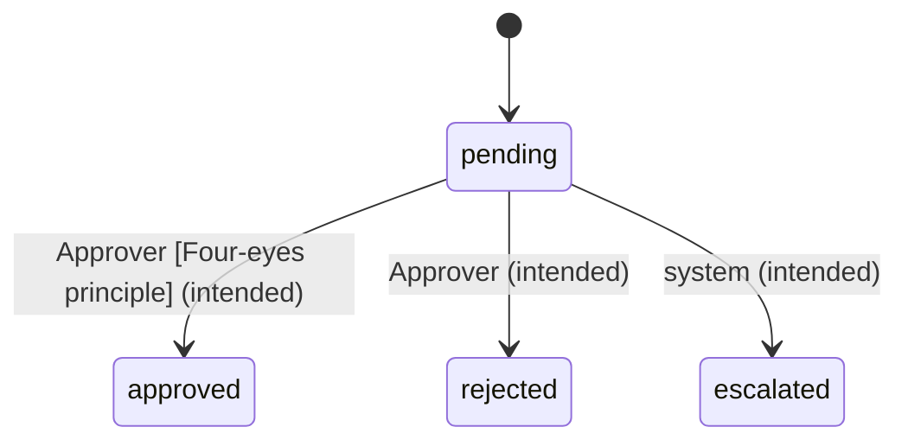

# Approval Request

Created when an [Order](/ordering/entities/order.md) above the threshold is submitted.[^apr-3]
Undecided requests are escalated after 3 working days.[^policy]

[^apr-3]: APR-3: Approval requests
[^policy]: Purchase approval policy v2

<!-- generated:start lifecycle -->
## Lifecycle

_Labels: (intended) = specified only · (actual) = seen in app or code only._
<!-- generated:end lifecycle -->

<!-- generated:start relations -->
## Relations

- belongs to → [Order](/ordering/entities/order.md) _(intended)_
- [Approval threshold](/approvals/rules/approval-threshold.md) governs this _(intended)_
- [Four-eyes principle](/approvals/rules/four-eyes.md) governs this _(intended)_
- [Approval inbox](/approvals/screens/approval-inbox.md) shows this _(actual)_
<!-- generated:end relations -->
