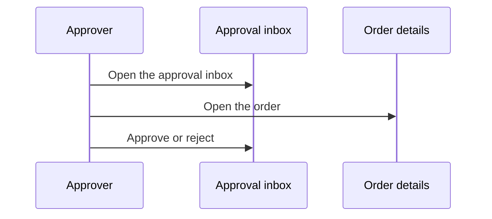

# Approve an order

[^apr-3]: APR-3: Approval requests

<!-- generated:start flow -->
## Flow

<!-- generated:end flow -->

<!-- generated:start relations -->
## Relations

- [Approver](/approvals/actors/approver.md) performs this _(intended)_
- [Approval inbox](/approvals/screens/approval-inbox.md) step of this
- [Order details](/ordering/screens/order-details.md) step of this
- ⚠ Gap (open): [No inbox link on Order details](/conflicts/no-inbox-link-on-order-details.md)
<!-- generated:end relations -->
