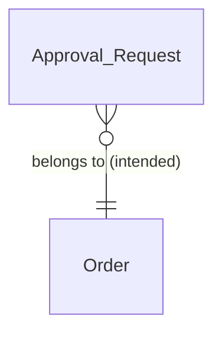
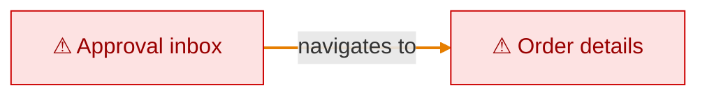

# Approvals map

Approvers accept or reject orders above the approval threshold

## Entities

_Labels: (intended) = specified only · (actual) = seen in app or code only._

## Navigation

_Legend: dashed arrow = intended only (not seen in app or code) · orange arrow = actual only (not specified) · red ⚠ = open Gap · grey = unverified._
