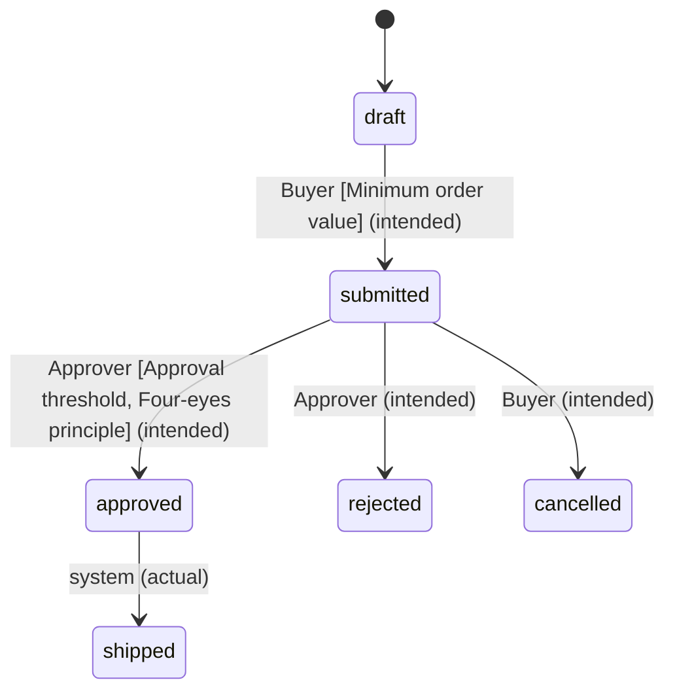

# Order

An Order is created as a **draft** by a [Buyer](/ordering/actors/buyer.md) and becomes **submitted** when the buyer sends it.[^ord-12]
Orders above the [approval threshold](/approvals/rules/approval-threshold.md) wait for an [Approver](/approvals/actors/approver.md).[^policy]

The API also moves approved orders to **shipped**; no ticket specifies this step.[^api]

[^ord-12]: ORD-12: Order lifecycle
[^policy]: Purchase approval policy v2
[^api]: Order schema (OpenAPI)

<!-- generated:start lifecycle -->
## Lifecycle

_Labels: (intended) = specified only · (actual) = seen in app or code only._
<!-- generated:end lifecycle -->

<!-- generated:start relations -->
## Relations

- has → [Order Line](/ordering/entities/order-line.md) _(intended)_
- belongs to → [Customer](/ordering/entities/customer.md)
- [Approval Request](/approvals/entities/approval-request.md) belongs to this _(intended)_
- [Approval threshold](/approvals/rules/approval-threshold.md) governs this _(intended)_
- [Approval inbox](/approvals/screens/approval-inbox.md) shows this _(actual)_
- [Customer](/ordering/entities/customer.md) has this _(intended)_
- [Order Line](/ordering/entities/order-line.md) belongs to this _(intended)_
- [Minimum order value](/ordering/rules/minimum-order-value.md) governs this _(intended)_
- [New order](/ordering/screens/new-order.md) shows this _(actual)_
- [Order details](/ordering/screens/order-details.md) shows this _(actual)_
- [Order list](/ordering/screens/order-list.md) shows this _(actual)_
- [PO](/ordering/terms/po.md) also known as this
- [Four-eyes principle](/approvals/rules/four-eyes.md) governs this
- ⚠ Gap (open): [Cancel without confirmation](/conflicts/cancel-without-confirmation.md)
<!-- generated:end relations -->
