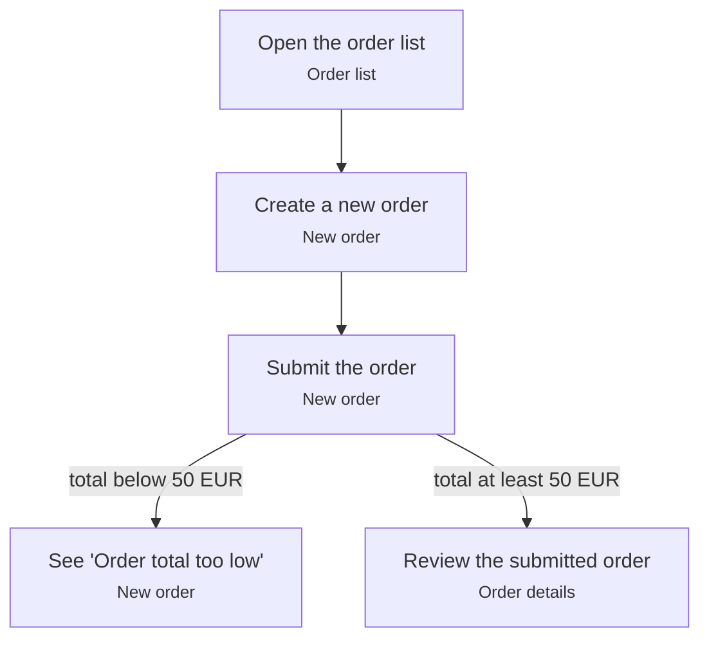

# Place an order

The Buyer's main journey.[^ord-12] See [Minimum order value](/ordering/rules/minimum-order-value.md).

[^ord-12]: ORD-12: Order lifecycle

<!-- generated:start flow -->
## Flow

<!-- generated:end flow -->

<!-- generated:start relations -->
## Relations

- [Buyer](/ordering/actors/buyer.md) performs this _(intended)_
- [Order list](/ordering/screens/order-list.md) step of this
- [New order](/ordering/screens/new-order.md) step of this
- [Order details](/ordering/screens/order-details.md) step of this
<!-- generated:end relations -->
