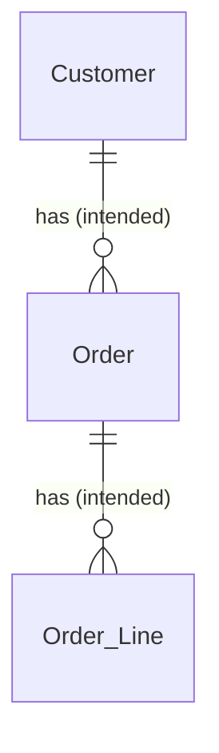
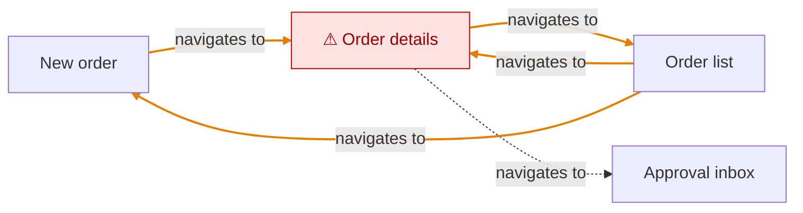

# Ordering map

Buyers create, submit and track purchase orders

## Entities

_Labels: (intended) = specified only · (actual) = seen in app or code only._

Open Gaps:
- ⚠ Order: [Cancel without confirmation](/conflicts/cancel-without-confirmation.md)

## Navigation

_Legend: dashed arrow = intended only (not seen in app or code) · orange arrow = actual only (not specified) · red ⚠ = open Gap · grey = unverified._
